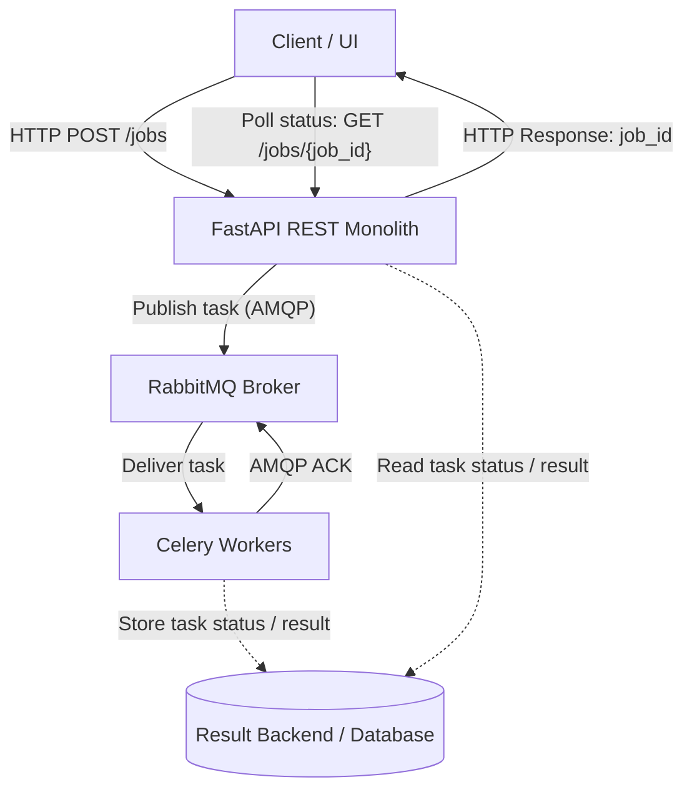

# Software Requirements Specification (SRS)
## Distributed Job Processing Platform

**Standard:** ISO/IEC/IEEE 29148 / IEEE 830
**Format:** GitHub Flavored Markdown (GFM)
**Version:** 1.0.0
**Status:** Approved

---

## 1. Introduction

### 1.1 Purpose
This Software Requirements Specification (SRS) document defines the functional and non-functional requirements for the **Distributed Job Processing Platform**. The system provides asynchronous job queueing, execution, and status tracking to decouple time-consuming background operations from the synchronous HTTP request-reply lifecycle.

### 1.2 Scope
The system consists of:
* **API Application (Modular Monolith):** FastAPI-based REST API for accepting job submissions, querying job statuses, and inspecting health metrics.
* **Asynchronous Message Broker:** RabbitMQ AMQP broker serving as the decoupling layer.
* **Distributed Task Workers:** Celery worker processes implementing the Competing Consumers pattern to process queued jobs asynchronously.
* **Result Backend:** RPC/AMQP temporary response channels and state backends for status retrieval.

### 1.3 Definitions, Acronyms, and Abbreviations
* **EDA:** Event-Driven Architecture
* **AMQP:** Advanced Message Queuing Protocol
* **DLQ:** Dead Letter Queue
* **Responsiveness:** Time elapsed from client request to immediate API acknowledgment (`HTTP 202 Accepted`).
* **At-Least-Once Delivery:** Guarantee that a message is delivered and processed at least once, even in the event of worker process failure.

---

## 2. Overall Description

### 2.1 Product Perspective
The system operates as an infrastructure middleware service within a distributed ecosystem. It sits between client applications (web frontends, external microservices) and heavy computational background routines (document generation, notification delivery, data processing).

### 2.2 Product Functions
1. **Job Enqueueing:** Accept JSON job payloads via `POST /api/v1/jobs` and issue an immediate `job_id`.
2. **Asynchronous Processing:** Route tasks to background Celery workers using RabbitMQ queues.
3. **Status & Result Retrieval:** Query real-time task state (`PENDING`, `STARTED`, `SUCCESS`, `FAILURE`) via `GET /api/v1/jobs/{job_id}`.
4. **Error Handling & Retries:** Automatically retry transient failures with exponential backoff; route unrecoverable failures to a Dead Letter Queue.
5. **Health Monitoring:** Expose broker connectivity and worker readiness endpoints at `GET /api/v1/health`.

### 2.3 User Characteristics
* **API Consumers / Frontend Engineers:** Require fast response times (<50ms) when submitting background tasks and predictable JSON schemas.
* **DevOps / System Administrators:** Require health endpoints, isolated process execution, and straightforward configuration via environment variables.

### 2.4 Constraints
* **Operating Environment:** Windows local environment without mandatory Docker containers.
* **Resource Budget:** Lightweight memory footprint (<250 MB total RAM for local development).
* **Protocol:** AMQP over TCP (`5672`).

---

## 3. Specific Requirements

### 3.1 Functional Requirements

#### FR-1: Job Submission
* **FR-1.1:** The API MUST expose a `POST /api/v1/jobs` endpoint accepting `job_type` and `payload`.
* **FR-1.2:** The API MUST validate incoming JSON against Pydantic schemas.
* **FR-1.3:** On valid submission, the API MUST publish an AMQP message to RabbitMQ and return `HTTP 202 Accepted` with a UUID4 `job_id` within 50ms.

#### FR-2: Asynchronous Execution
* **FR-2.1:** Celery workers MUST consume tasks from RabbitMQ using the Competing Consumers pattern.
* **FR-2.2:** Workers MUST acknowledge tasks (`ACK`) ONLY after execution finishes (`task_acks_late=True`).
* **FR-2.3:** Tasks MUST support idempotent execution keys to prevent duplicate side-effects.

#### FR-3: Status Tracking
* **FR-3.1:** The API MUST expose `GET /api/v1/jobs/{job_id}` to query task execution state.
* **FR-3.2:** Returned statuses MUST be one of: `PENDING`, `STARTED`, `SUCCESS`, `RETRY`, `FAILURE`.

---

### 3.2 Non-Functional Requirements (Architecture Characteristics)

#### NFR-1: Responsiveness
* API request latency for job enqueuing MUST NOT exceed **50ms** under normal load, decoupling UI response time from task execution time.

#### NFR-2: Fault Tolerance & Reliability
* If a worker process crashes mid-execution (`SIGKILL` or OOM), the unacknowledged message MUST be automatically re-queued by RabbitMQ and assigned to another active worker (*At-Least-Once Delivery*).

#### NFR-3: Scalability & Elasticity
* Worker nodes MUST be statelessly scalable. Additional worker processes (`python run_worker.py`) can be launched dynamically without modifying API code or restarting the broker.

#### NFR-4: Maintainability & Testability
* The API and worker code MUST support an isolated in-memory testing mode (`task_always_eager=True`, `task_store_eager_result=True`) allowing 100% unit and integration test coverage without external service dependencies.
